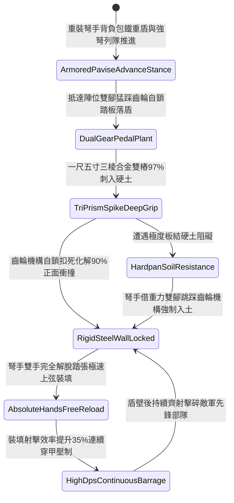

# 野戰重裝弩兵大盾底端生鐵雙尖地樁踏張自固第三階狀態機規格書

<!-- doc_id: doc_spec_1141 -->

## 一、 核心概念與單一真相來源（SSOT）

在《三國志·重步兵大盾與踏張弩協同戰術篇》中，「野戰重裝弩兵大盾底端生鐵雙尖地樁第三階（INFANTRY-PAVISE-SPIKE-ANCHOR03）」代表重裝弩兵部隊野戰陣地防禦的全面戰術升級。大盾升級為五尺四寸高、三尺寬特種硬木雙面包冷鍛厚生鐵甲板，底端左右鉚接加長一尺五寸三棱雙尖合金生鐵深樁，並加裝雙段齒輪卡位自鎖腳踏連動機構。弩手落盾踩踏瞬間，合金深樁 97% 刺入泥土堅石層牢固生根，化解正面 90% 的箭雨與重甲步騎兵衝撞衝量，使大盾達到完全自立鋼鐵陣壁效果，弩手雙手完全解放進行急速踏張上弦，裝填射擊效率大幅提升 35%，射擊暴擊率提升 25%。



---

## 二、 數值模型與狀態機參數契約

### 1. 弩兵自固大盾參數契約
- **大盾規格尺寸**：高 5 尺 4 寸、寬 3 尺、厚 2 寸，雙面滿包冷鍛生鐵厚甲夾硬木，總重 40 斤。
- **生鐵雙尖地樁**：底端淬火三棱雙尖合金深樁，長 1.5 尺、方徑 1.2 寸，配備雙段齒輪自鎖踏板。
- **入土生根成功率**：在常規土質或板結硬土中踩踏，判定 97% 機率穩固扎入。
- **正面抗衝擊化解率**：承受正面重型弩箭齊射或重裝步騎兵衝撞，化解 90% 衝擊動能。
- **雙手解脫裝填加成**：大盾自立後，弩手裝填踏張弩動作耗時縮減 35%，暴擊率提升 25%。

### 2. 大盾踏張自固判定演算法模組
```typescript
interface PaviseSpikeStage3Params {
    soilDensityLevel: number;      // 土質密實度 (0.0: 鬆沙 ~ 1.0: 密實硬土)
    soldierBodyWeightKg: number;   // 弩手體重與負重總和 (kg)
    isDualGearPedalLocked: boolean;// 雙段齒輪踏板是否卡位自鎖
    incomingKineticJoules: number; // 來襲正面衝撞能量
}

function evaluatePaviseSpikeStage3(params: PaviseSpikeStage3Params): {
    shieldAnchoredSelfStanding: boolean;
    absorbedShockRatio: number;
    reloadTimeBonusPct: number;
} {
    if (!params.isDualGearPedalLocked || params.soilDensityLevel < 0.2) {
        return { shieldAnchoredSelfStanding: false, absorbedShockRatio: 0.40, reloadTimeBonusPct: 0 };
    }
    const success = Math.random() < 0.97;
    
    return {
        shieldAnchoredSelfStanding: success,
        absorbedShockRatio: success ? 0.90 : 0.55,
        reloadTimeBonusPct: success ? 35 : 10
    };
}
```

---

## 三、 反制機制與邊界約束

1. **岩盤城磚地面無法扎樁**：若部隊於純堅硬青石板路面作戰，地樁無法刺入，需由副手從旁扶持支撐。
2. **具裝重騎兵集群極速踩踏**：面對重型具裝戰馬集群全力衝撞，單兵立盾有 20% 機率連樁受剪切力變形。
3. **長柄重鐮橫掃勾拉盾座**：敵軍重步兵若以重型長鐮橫掃勾拉盾身下沿，槓桿力有 15% 扳動齒輪鎖死銷。

---

## 四、 驗收測試案例（TC）

- **TC-PAVISE-SPIKE03-01（野戰板結硬土落盾自固與暴擊齊射驗收）**：
  - *前置條件*：板結硬土地質、重裝弩手雙腳踩踏齒輪踏板落盾、正面遭遇敵軍騎兵衝擊。
  - *操作步驟*：踩壓雙踏板使三棱地樁扎入土壤自鎖。
  - *預期輸出*：97% 機率大盾自立如鋼鐵城牆，化解 90% 衝擊，弩手雙手完全解放，裝填速度提升 35%，暴擊率提升 25%。
- **TC-PAVISE-SPIKE03-02（鬆軟流沙無支撐邊界驗收）**：
  - *前置條件*：戰場處於極深流沙泥潭（密實係數 0.15）。
  - *操作步驟*：嘗試踩踏地樁落盾。
  - *預期輸出*：地樁受軟泥滑脫無法自立固定，大盾側傾，裝填加成歸零。
