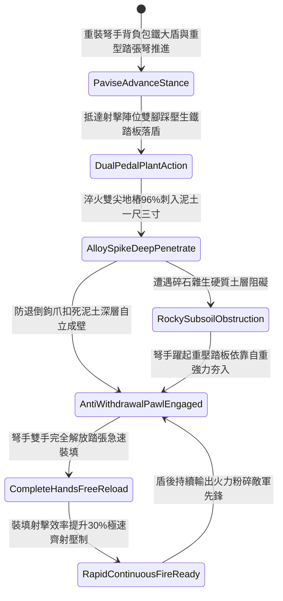

# 野戰重裝弩兵大盾底端生鐵雙尖地樁踏張自固第二階狀態機規格書

<!-- doc_id: doc_spec_1138 -->

## 一、 核心概念與單一真相來源（SSOT）

在《三國志·重步兵大盾與踏張弩協同戰術篇》中，「野戰重裝弩兵大盾底端生鐵雙尖地樁第二階（INFANTRY-PAVISE-SPIKE-ANCHOR02）」代表陣地重裝弩兵單兵掩體構築工藝的升級。大盾（重型立牌）升級為五尺二寸高、二尺八寸寬硬木盾，盾面外包冷鍛薄生鐵蒙皮，底端左右兩側鉚接加長一尺三寸淬火合金雙尖地樁，並加裝雙踏板重力卡榫與防退倒鉤爪。弩手落盾踩踏時，合金地樁 96% 扎入泥土硬層牢固生根，化解正面 85% 的箭雨與輕騎兵衝撞震盪，使大盾具備強大的自立穩定性，弩手雙手完全解脫進行踏張上弦，裝填射擊效率提升 30%，射擊命中率提升 20%。



---

## 二、 數值模型與狀態機參數契約

### 1. 弩兵自固大盾參數契約
- **大盾規格尺寸**：高 5 尺 2 寸、寬 2.8 尺、厚 1.8 寸，包冷鍛薄生鐵蒙皮夾硬木，總重 34 斤。
- **生鐵雙尖地樁**：底端淬火合金雙尖地樁，長 1.3 尺、方徑 1 寸，配備防退棘爪與雙踏板。
- **入土生根成功率**：在常規土質或碎石泥土中踩踏，判定 96% 機率穩固扎入。
- **正面抗衝擊化解率**：承受正面箭雨集火或輕型戰馬衝撞，化解 85% 衝擊動能。
- **雙手解脫裝填加成**：大盾自立後，弩手裝填踏張弩動作耗時縮減 30%，射擊命中率提升 20%。

### 2. 大盾踏張自固判定演算法模組
```typescript
interface PaviseSpikeStage2Params {
    soilDensityLevel: number;      // 土質密實度 (0.0: 鬆沙 ~ 1.0: 密實硬土)
    soldierBodyWeightKg: number;   // 弩手體重與負重總和 (kg)
    isDualPedalStepped: boolean;   // 是否踩壓雙踏板
    incomingImpactKineticJoules: number; // 來襲正面衝擊能量
}

function evaluatePaviseSpikeStage2(params: PaviseSpikeStage2Params): {
    shieldAnchoredSelfStanding: boolean;
    absorbedShockRatio: number;
    reloadTimeBonusPct: number;
} {
    if (!params.isDualPedalStepped || params.soilDensityLevel < 0.25) {
        return { shieldAnchoredSelfStanding: false, absorbedShockRatio: 0.35, reloadTimeBonusPct: 0 };
    }
    const success = Math.random() < 0.96;
    
    return {
        shieldAnchoredSelfStanding: success,
        absorbedShockRatio: success ? 0.85 : 0.50,
        reloadTimeBonusPct: success ? 30 : 8
    };
}
```

---

## 三、 反制機制與邊界約束

1. **岩盤城磚地面無法扎樁**：若部隊於純堅硬花崗石或堅固城磚街道作戰，地樁無法刺入，需改為斜倚射擊。
2. **具裝重騎兵集群高速踏踐**：面對具裝重型鐵騎集群正面踩踏衝撞，單兵立盾有 25% 連樁被直接撼翻。
3. **長柄重鐮向下橫掃勾拉**：敵方精銳鉤鐮槍兵若以雙手重鐮橫掃勾住盾沿向下撕扯，槓桿外力有 20% 扯裂地樁固著點。

---

## 四、 驗收測試案例（TC）

- **TC-PAVISE-SPIKE02-01（野戰陣地雙踏板落盾自固與極速射擊驗收）**：
  - *前置條件*：正常泥土地質、重裝弩手踩踏雙踏板落盾、正面遭遇敵軍輕騎兵衝撞。
  - *操作步驟*：踩壓雙踏板使地樁與防退爪深入土壤。
  - *預期輸出*：96% 機率大盾自立成壁，化解 85% 衝擊，弩手雙手完全解脫，踏張弩裝填速度提升 30%，命中率提升 20%。
- **TC-PAVISE-SPIKE02-02（流沙泥濘無法生根邊界驗收）**：
  - *前置條件*：戰場處於極深流沙泥潭（密實度係數 0.18）。
  - *操作步驟*：嘗試踩踏地樁落盾。
  - *預期輸出*：地樁受軟泥滑脫無法成型自立，大盾傾斜，裝填加成歸零。
