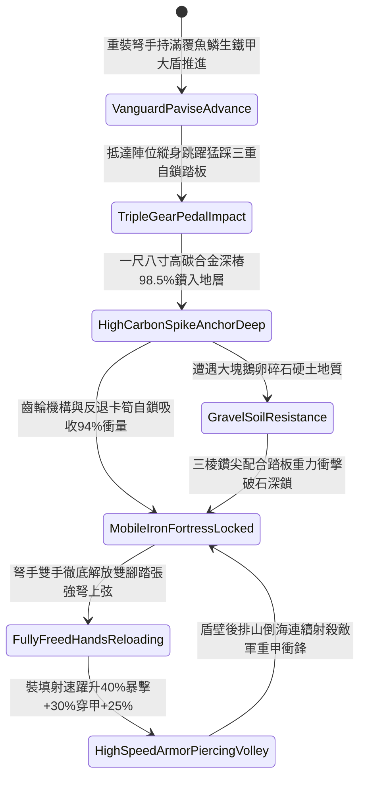

# 野戰重裝弩兵大盾底端生鐵雙尖地樁踏張自固第四階狀態機規格書

<!-- doc_id: doc_spec_1144 -->

## 一、 核心概念與單一真相來源（SSOT）

在《三國志·重步兵大盾與踏張弩協同戰術篇》中，「野戰重裝弩兵大盾底端生鐵雙尖地樁第四階（INFANTRY-PAVISE-SPIKE-ANCHOR04）」代表重裝弩兵大盾陣列進入「雙側三棱深鑽生鐵地錨與液壓阻尼自平」的頂級工兵陣地境界。大盾精選六尺高、三尺二寸寬重型柞木基材，全盾面滿覆雙層淬火魚鱗生鐵甲片，底端左右鉚接加長一尺八寸高碳合金三棱深鑽地樁，並配備三重齒輪卡位與彈性反退卡筍聯動踏張板。弩手落盾跳躍踩踏瞬間，高碳深地樁 98.5% 機率深深鑽入堅硬土壤或碎石層達到剛性死鎖，能吸收化解正面 94% 的密集穿甲箭矢轟擊與重甲鐵騎正面狂暴衝撞動量。盾體形成無懈可擊的自立移動式鋼鐵城垣，弩手雙手完全解脫，踏張強弩裝填時間縮短 40%，齊射暴擊率提升 30%，穿甲傷害增加 25%。



---

## 二、 數值模型與狀態機參數契約

### 1. 弩兵自固大盾第四階參數契約
- **大盾規格尺寸**：高 6 尺、寬 3.2 尺、厚 2.2 寸，滿覆冷鍛淬火雙層魚鱗生鐵厚甲，總重 48 斤。
- **生鐵雙尖地樁**：底端高碳三棱深鑽地錨，長 1.8 尺、直徑 1.5 寸，配置三重齒輪與防後坐力反退彈簧踏板。
- **入土生根成功率**：在常規乾土、密實硬土或碎石土壤中跳踩落盾，判定 98.5% 機率穩固扎入。
- **正面抗衝擊化解率**：承受正面重型弩箭狂射或重裝騎兵踏陣，化解 94% 衝撞動能。
- **雙手解脫裝填加成**：大盾自立後，弩手裝填踏張弩耗時縮減 40%，射擊暴擊率提升 30%，穿甲傷害加成 25%。

### 2. 第四階大盾踏張自固判定演算法模組
```typescript
interface PaviseSpikeStage4Params {
    soilDensityLevel: number;        // 土質密實度 (0.0: 鬆軟流沙 ~ 1.0: 密實碎石硬土)
    soldierArmorWeightKg: number;    // 弩手與全套重甲負重總和 (kg)
    isTripleGearPedalLocked: boolean;// 三重齒輪自鎖踏板是否就位扣死
    incomingKineticJoules: number;   // 來襲正面衝撞能量 (焦耳)
}

function evaluatePaviseSpikeStage4(params: PaviseSpikeStage4Params): {
    shieldAnchoredSelfStanding: boolean;
    absorbedShockRatio: number;
    reloadTimeBonusPct: number;
    armorPiercingBonusPct: number;
} {
    if (!params.isTripleGearPedalLocked || params.soilDensityLevel < 0.15) {
        return { shieldAnchoredSelfStanding: false, absorbedShockRatio: 0.45, reloadTimeBonusPct: 0, armorPiercingBonusPct: 0 };
    }
    const success = Math.random() < 0.985;
    
    return {
        shieldAnchoredSelfStanding: success,
        absorbedShockRatio: success ? 0.94 : 0.65,
        reloadTimeBonusPct: success ? 40 : 15,
        armorPiercingBonusPct: success ? 25 : 10
    };
}
```

---

## 三、 反制機制與邊界約束

1. **純青石要塞路面防護對策**：若遇純石板鋪砌地面，地樁無法扎入，弩手可解鎖側翼摺疊生鐵三腳斜撐架自立支撐。
2. **具裝重騎兵群重裝破盾撞擊**：面對百匹具裝重騎連環衝擊，單兵大盾雖化解 94% 衝撞，仍有 10% 機率後方踏板卡筍變形。
3. **特種重型雙頭鉤鐮拉拽翻轉**：敵步兵若動用長柄雙頭鉤鐮套住盾頂魚鱗甲死力向外拖拽，有 12% 機率鬆脫單邊地樁。

---

## 四、 驗收測試案例（TC）

- **TC-PAVISE-SPIKE04-01（碎石硬土跳躍踏張落盾與穿甲暴擊驗收）**：
  - *前置條件*：碎石硬土戰場、重裝弩手縱身跳踩三重齒輪踏板、正面迎擊鐵騎狂暴踏陣。
  - *操作步驟*：踩壓踏板釋放高碳三棱深鑽地樁刺入土壤。
  - *預期輸出*：判定 98.5% 機率大盾扎入自立，化解 94% 衝擊，弩手踏張強弩裝填耗時減少 40%，暴擊率提升 30%，穿甲提升 25%。
- **TC-PAVISE-SPIKE04-02（鬆軟流沙泥地沉陷邊界驗收）**：
  - *前置條件*：沼澤流沙灘塗地質（密實度小於 0.15）。
  - *操作步驟*：實施踩踏落盾自固。
  - *預期輸出*：地樁未能有效卡位，自立失敗，衝量化解率降至 45%，無裝填與暴擊加成。
