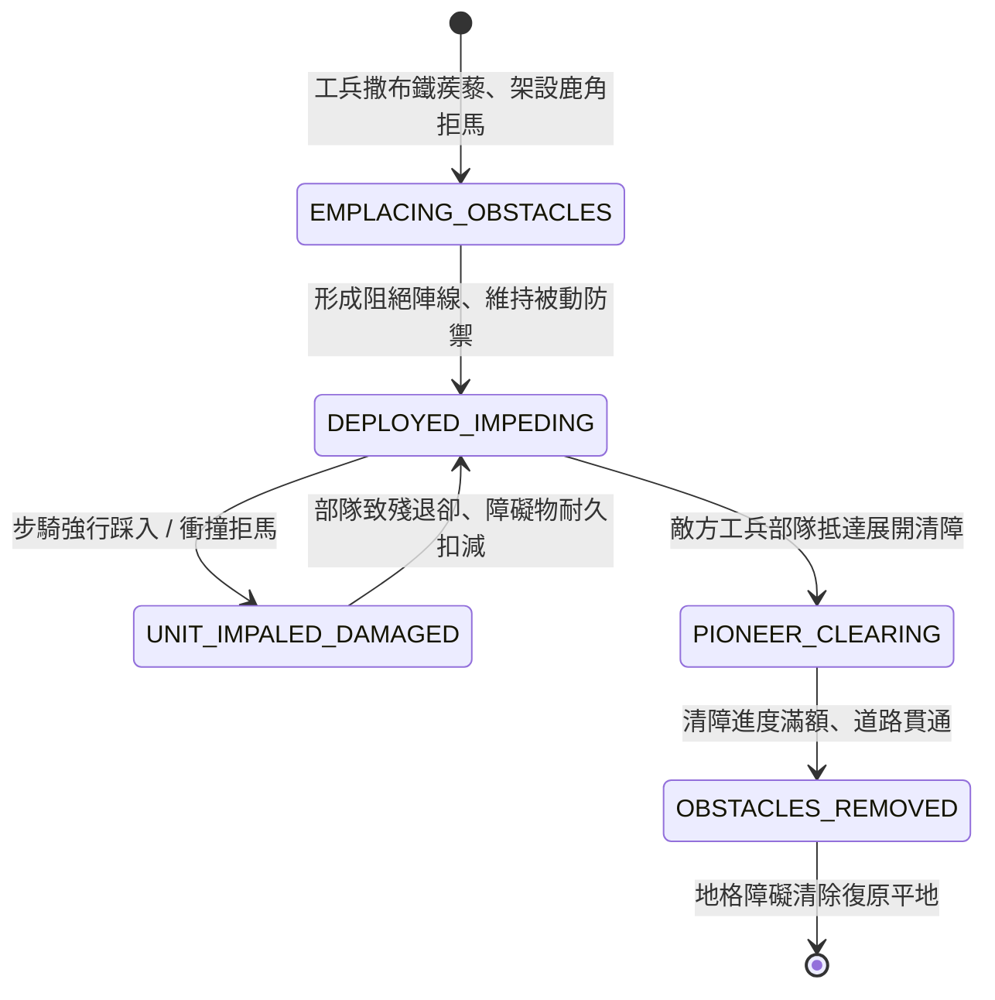

<!-- doc_id: doc_spec_0800 -->
# 3KLife 鐵蒺藜鹿角拒馬阻截步騎突破與工兵工兵鏟清障狀態機規格書

## 模組基本資訊
- **模組代號**：`CALTROP-CHEVAUX-DE-FRISE01`
- **系統定位**：三國野戰地表被動阻礙與步騎通行阻截系統，負責四角鐵蒺藜撒布、交錯木質鹿角拒馬架設、衝鋒撕裂傷害與工兵排障清道之完整流程。
- **架構依賴**：`BattleGridSystem`、`TroopTypeMovement`、`PioneerEngineering`、`VFXBlockRegistry`。

---

## 核心設計概念
三國時期陣地戰與隘口防禦，守軍步兵面對敵軍步騎大規模衝陣，必先撒布大量生鐵鑄造之四角「鐵蒺藜」（無論如何拋擲皆有一尖刺垂直朝上），並組裝粗大圓木削尖交錯之「鹿角拒馬」。敵步兵草鞋踩踏立刻刺穿足底動彈不得；敵騎兵衝撞拒馬則馬胸被尖樁貫穿。若進攻方需開闢通道，必須指派重裝盾工兵手持工兵鏟與長鐵鉗冒死拆除清障。



---

## 狀態機定義與轉換條件

### 1. `EMPLACING_OBSTACLES`（架設布設狀態）
- **進入條件**：己方部隊具備「阻絕材料」，於陣前相鄰空曠地格下達「布置鹿角拒馬」或「撒布鐵蒺藜」指令。
- **行為表現**：
  - 工兵消耗 1 回合時間完成施工，地格獲得「鐵蒺藜」或「鹿角拒馬」實體標籤。
  - 耐久度分別為：鐵蒺藜 200 點、鹿角拒馬 600 點。
- **轉換**：施工完成 -> 轉移至 `DEPLOYED_IMPEDING`。

### 2. `DEPLOYED_IMPEDING`（陣線阻絕狀態）
- **行為表現**：
  - **移動阻滯**：通過鐵蒺藜地格每步消耗額外 2 點行動力；鹿角拒馬地格對騎兵為完全阻擋（ZOC 強制截停）。
  - **微弱隱蔽**：鐵蒺藜具備 60% 隱蔽度，敵軍非斥候部隊不易察覺。
- **轉換**：
  - 敵單位踩踏或衝撞 -> 轉移至 `UNIT_IMPALED_DAMAGED`。
  - 敵工兵小組上前排障 -> 轉移至 `PIONEER_CLEARING`。

### 3. `UNIT_IMPALED_DAMAGED`（穿刺受創結算狀態）
- **行為表現**：
  - **步兵踏中鐵蒺藜**：立即受到 180 點穿刺傷害，並附加「足底重創」減益（移動力 -50%，持續 2 回合）。
  - **騎兵撞擊鹿角拒馬**：依衝鋒速度造成 400~750 點反衝貫穿傷害，戰馬哀鳴暴斃，衝鋒加成清零。
  - 障礙物扣減對應耐久度。
- **轉換**：傷害數值結算完畢 -> 回歸 `DEPLOYED_IMPEDING` 或耐久歸零破滅。

### 4. `PIONEER_CLEARING`（工兵清障作業狀態）
- **行為表現**：
  - 工兵或重步兵於相鄰地格使用鏟鉗清除蒺藜或鋸斷拒馬木樁。
  - 每回合推進清障進度 35%，若作業期間遭受遠程箭矢射擊，進度推進減半。
- **轉換**：清障進度達到 100% -> 轉移至 `OBSTACLES_REMOVED`。

### 5. `OBSTACLES_REMOVED`（障礙掃除貫通狀態）
- **行為表現**：
  - 地格阻絕標籤移除，播放碎木被推開與蒺藜清空特效。
  - 道路恢復原本基礎通行成本。
- **轉換**：地貌屬性復原完成 -> 結束退出。

---

## 數值公式與配置契約

```typescript
export interface ObstacleImpedanceConfig {
  obstacleId: string;
  obstacleType: 'CALTROP_FIELD' | 'CHEVAUX_DE_FRISE' | 'MIXED_BARRIER';
  durabilityMax: number;          // 障礙實體耐久上限
  movementCostDelta: number;      // 移動力額外消耗
  infantryPunctureDamage: number; // 步兵刺穿基礎傷害
  cavalryChargeRecoilMult: number;// 騎兵衝鋒反衝傷害倍率
  clearanceTurnCost: number;      // 工兵清障所需標準回合數
}

export const OBSTACLE_PRESETS: Record<string, ObstacleImpedanceConfig> = {
  FOUR_SPIKE_CALTROP: {
    obstacleId: 'OBS_CALTROP_01',
    obstacleType: 'CALTROP_FIELD',
    durabilityMax: 200,
    movementCostDelta: +2,
    infantryPunctureDamage: 180,
    cavalryChargeRecoilMult: 1.2,
    clearanceTurnCost: 2,
  },
  HEAVY_WOODEN_CHEVAUX: {
    obstacleId: 'OBS_CHEVAUX_01',
    obstacleType: 'CHEVAUX_DE_FRISE',
    durabilityMax: 600,
    movementCostDelta: +99, // 騎兵完全阻斷
    infantryPunctureDamage: 80,
    cavalryChargeRecoilMult: 2.8,
    clearanceTurnCost: 3,
  }
};
```

---

## 單元測試與驗收標準
1. **騎兵衝撞反衝檢定**：騎兵單位以衝鋒狀態（速度 >= 4）撞擊 `HEAVY_WOODEN_CHEVAUX` 時，反衝傷害乘上 2.8 倍，且移動力即刻歸零。
2. **步兵足底穿刺減益**：步兵行經 `FOUR_SPIKE_CALTROP` 地格後，確實被附加「足底重創」Debuff，移動力減半持續 2 回合。
3. **工兵清障通道貫通**：工兵小組執行清障作業達指定進度後，地格狀態轉入 `OBSTACLES_REMOVED`，障礙完全消失且阻擋判定解除。
