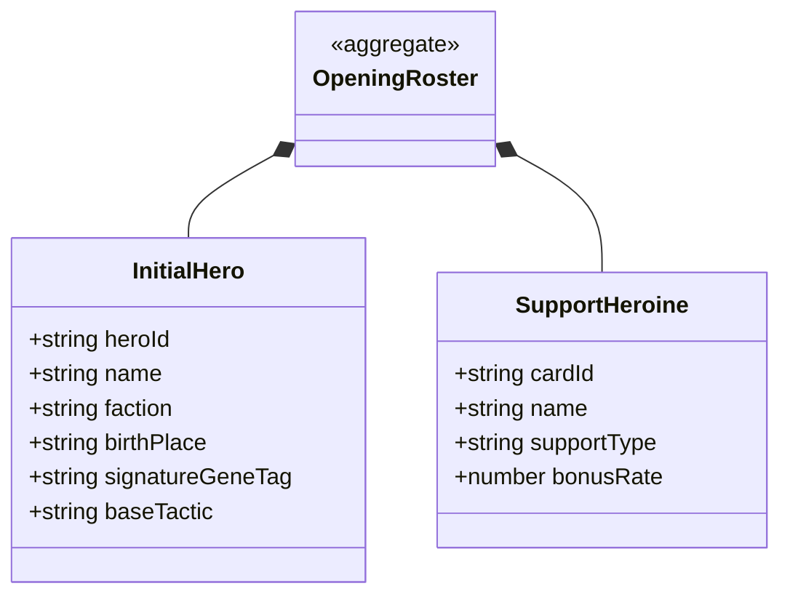

# 開場初始六名將與紅顏支援卡資料契約規格書

<!-- doc_id: doc_spec_0618 -->

> 本規格書依據 WBS `OPEN-02`（開場資料表：HeroBase/SupportCardBase/初始六名將/紅顏/因子標籤/祖先矩陣）制定，為遊戲開場引導武將池與支援卡之單一真相來源（Single Source of Truth）。
> 核心約束：無副作用純邏輯架構、初始六名將嚴格資料 Schema、紅顏三美支援卡被動賦能、血脈祖先矩陣種子對位、全繁體中文台灣慣用術語。

---

## 1. 業務定位與開場角色矩陣

玩家進入遊戲開局時，系統依據陣營勢力提供「初始六名將（三國各 2 位）」作為宿命開局選秀卡池，並配置「紅顏三美支援卡」提供早期養成輔助。



---

## 2. 初始六名將（Initial Six Heroes）規格表

六位初始名將各自承載經典歷史血統標籤與初始天賦戰法，資料結構如下：

| 武將 ID | 武將姓名 | 歸屬勢力 | 郡望出生地 | 始祖血脈因子標籤 | 初始天賦戰法 |
|---|---|---|---|---|---|
| `HERO_ZHANG_FEI` | 張飛 | 蜀漢 | 幽州涿郡 | `GENE_ROAR_OF_YAN`（破陣咆哮） | 當陽斷橋喝退 |
| `HERO_WEI_YAN` | 魏延 | 蜀漢 | 荊州義陽 | `GENE_AMBUSH_STRIKE`（子午奇襲） | 反骨拔刃連斬 |
| `HERO_XIAHOU_DUN` | 夏侯惇 | 曹魏 | 豫州譙縣 | `GENE_INDOMITABLE_EYE`（拔矢啖睛） | 盲侯血誓不退 |
| `HERO_ZHANG_HE` | 張郃 | 曹魏 | 冀州鄚縣 | `GENE_TACTICAL_FLEX`（巧變靈活） | 奇正地形縱橫 |
| `HERO_SUN_CE` | 孫策 | 東吳 | 揚州吳郡 | `GENE_OVERLORD_FURY`（江東小霸王） | 霸王疾風破陣 |
| `HERO_GAN_NING` | 甘寧 | 東吳 | 益州巴郡 | `GENE_JINFAN_VALOR`（錦帆夜襲） | 錦帆百騎劫營 |

---

## 3. 紅顏三美支援卡（Support Heroines）規格表

紅顏支援卡作為教官與內政陪同，直接在早期學府培育與戰場中提供增益：

| 支援卡 ID | 角色姓名 | 定位類型 | 專屬支援被動效能 | 觸發場景 |
|---|---|---|---|---|
| `SUP_DIAO_CHAN` | 貂蟬 | 魅力計略型 | 魅力屬性訓練效果 $+30\%$，全計策精力消耗 $-20\%$ | 潁川書院清談／大廳任務 |
| `SUP_ZHEN_JI` | 甄姬 | 治癒內政型 | 水域與林地作戰適性 $+1$ 階，戰後傷兵救回率 $+25\%$ | 戰後結算／領地巡視 |
| `SUP_XIAO_QIAO` | 小喬 | 暴擊福緣型 | 戰場物理與計策暴擊率 $+15\%$，世家名聲獲取翻倍 | 出征戰鬥／世家社交 |

---

## 4. 資料模型與驗證純函式

```typescript
export interface IInitialHeroConfig {
    readonly heroId: string;
    readonly name: string;
    readonly faction: 'SHU' | 'WEI' | 'WU';
    readonly birthPlace: string;
    readonly geneTag: string;
    readonly signatureTactic: string;
    readonly baseLea: number;
    readonly baseStr: number;
    readonly baseInt: number;
}

export interface ISupportHeroineConfig {
    readonly cardId: string;
    readonly name: string;
    readonly supportType: 'CHARISMA' | 'HEALING' | 'FORTUNE';
    readonly bonusPercent: number;
}

export function validateInitialRoster(
    heroes: readonly IInitialHeroConfig[],
    heroines: readonly ISupportHeroineConfig[]
): boolean {
    if (heroes.length !== 6 || heroines.length !== 3) return false;

    // 檢查三國各 2 位名將
    const counts = { SHU: 0, WEI: 0, WU: 0 };
    for (const h of heroes) {
        if (!h.heroId || !h.name || !h.geneTag) return false;
        counts[h.faction] = (counts[h.faction] ?? 0) + 1;
    }
    if (counts.SHU !== 2 || counts.WEI !== 2 || counts.WU !== 2) return false;

    // 檢查紅顏三美
    const types = new Set(heroines.map(h => h.supportType));
    return types.size === 3;
}
```

---

## 5. 驗收測試案例（Test Cases）

| 測試編號 | 測試情境 | 輸入條件 | 預期輸出 |
|---|---|---|---|
| `TC-OPEN-HERO-01` | 六初始名將三國平衡驗證 | 蜀漢2、曹魏2、東吳2 名將清單 | `validateInitialRoster=true` |
| `TC-OPEN-HERO-02` | 陣營失衡防禦攔截 | 蜀漢3、曹魏2、東吳1 名將清單 | `validateInitialRoster=false` |
| `TC-OPEN-HERO-03` | 紅顏三美支援類型排他 | 魅力、治癒、福緣三類皆具備 | 驗證通過，各自支援特性生效 |
| `TC-OPEN-HERO-04` | 始祖基因標籤完整性 | 六位名將各具非空 `geneTag` | 基因注入成功，可順利繼承至血統樹 |
