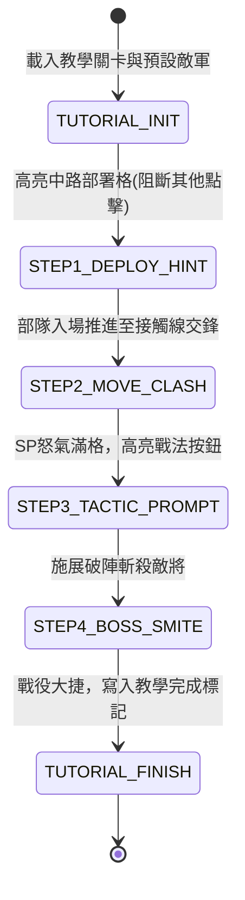

# 開場首戰五路教學戰流程控制器與提示浮窗狀態機規格書

<!-- doc_id: doc_spec_0619 -->

> 本規格書依據 WBS `OPEN-07`（首戰教學戰：5路x8格與教學提示浮窗）制定，為新手首場教學戰役與引導遮罩狀態機之單一真相來源（Single Source of Truth）。
> 核心約束：無副作用純邏輯架構、五步順序強制引導狀態機、高亮遮罩阻斷與點擊防穿透、教學完成原子存檔、全繁體中文台灣慣用術語。

---

## 1. 業務定位與教學戰流程狀態機

開場首戰旨在讓新手在 5 路 $\times$ 8 格標準棋盤上熟悉部隊部署、前進推推樂與戰法釋放節奏。整個教學流程由順序狀態機（Sequential State Machine）嚴格受控：



---

## 2. 教學提示浮窗與高亮遮罩協議

### 2.1 聚焦遮罩（Focus Mask Cutout）
- 當處於引導步驟時，全螢幕覆蓋 70% 透明度之黑色遮罩（`node_tutorial_mask`）。
- 目標區域（如中路地格 `(2, 0)` 或戰法按鈕）挖出穿透孔（Cutout Hole），**僅允許點擊穿透孔內目標**，孔外所有觸控事件強制阻斷攔截。

### 2.2 手勢與動態提示
- 步驟 1（部署）：手指動畫由底部卡牌滑動至中路地格。
- 步驟 3（戰法）：手指動畫在戰法按鈕上持續微幅縮放跳動（Pulse 效果）。

### 2.3 流程完成原子寫入
當 `TUTORIAL_FINISH` 觸發時，系統透過原子交易寫入存檔：
- `tutorial_first_battle_completed = true`
- 獎勵解鎖：初始銅錢 $\times 2000$、求籤令 $\times 10$。
- 後續開新存檔若檢測到歷史通關記錄，允許主動跳過該場教學戰。

---

## 3. 資料模型與狀態轉移純函式

```typescript
export type TutorialStep =
    | 'INIT'
    | 'STEP1_DEPLOY'
    | 'STEP2_CLASH'
    | 'STEP3_TACTIC'
    | 'STEP4_VICTORY'
    | 'COMPLETED';

export interface ITutorialState {
    readonly currentStep: TutorialStep;
    readonly highlightedNodeKey: string | null;
    readonly isInputBlocked: boolean;
    readonly isCompleted: boolean;
}

export function initTutorialState(): ITutorialState {
    return {
        currentStep: 'STEP1_DEPLOY',
        highlightedNodeKey: 'TILE_DEPLOY_LANE_3',
        isInputBlocked: true,
        isCompleted: false,
    };
}

export function advanceTutorialStep(currentState: ITutorialState, actionKey: string): ITutorialState {
    switch (currentState.currentStep) {
        case 'STEP1_DEPLOY': {
            if (actionKey === 'DEPLOY_HERO_SUCCESS') {
                return {
                    currentStep: 'STEP2_CLASH',
                    highlightedNodeKey: null,
                    isInputBlocked: false, // 允許觀看自動推兵交鋒
                    isCompleted: false,
                };
            }
            return currentState;
        }
        case 'STEP2_CLASH': {
            if (actionKey === 'SP_METER_FULL') {
                return {
                    currentStep: 'STEP3_TACTIC',
                    highlightedNodeKey: 'BTN_TACTIC_SLOT_1',
                    isInputBlocked: true, // 鎖定戰法按鈕
                    isCompleted: false,
                };
            }
            return currentState;
        }
        case 'STEP3_TACTIC': {
            if (actionKey === 'TACTIC_CAST_SUCCESS') {
                return {
                    currentStep: 'STEP4_VICTORY',
                    highlightedNodeKey: null,
                    isInputBlocked: true,
                    isCompleted: false,
                };
            }
            return currentState;
        }
        case 'STEP4_VICTORY': {
            if (actionKey === 'SETTLEMENT_CONFIRMED') {
                return {
                    currentStep: 'COMPLETED',
                    highlightedNodeKey: null,
                    isInputBlocked: false,
                    isCompleted: true,
                };
            }
            return currentState;
        }
        default:
            return currentState;
    }
}
```

---

## 4. 驗收測試案例（Test Cases）

| 測試編號 | 測試情境 | 輸入條件 | 預期輸出 |
|---|---|---|---|
| `TC-TUTOR-01` | 開局鎖定中路部署 | 初始狀態 | `currentStep='STEP1_DEPLOY'`, `highlightedNodeKey='TILE_DEPLOY_LANE_3'` |
| `TC-TUTOR-02` | 部署完成推進戰鬥 | 輸入 `DEPLOY_HERO_SUCCESS` | 進入 `STEP2_CLASH`，解除全域阻斷進入交鋒 |
| `TC-TUTOR-03` | 怒氣滿額鎖定戰法按鈕 | 輸入 `SP_METER_FULL` | 進入 `STEP3_TACTIC`，高亮鎖定 `BTN_TACTIC_SLOT_1` |
| `TC-TUTOR-04` | 戰鬥勝利結算完成 | 輸入 `SETTLEMENT_CONFIRMED` | 進入 `COMPLETED`, `isCompleted=true`，存檔旗標持久化 |
