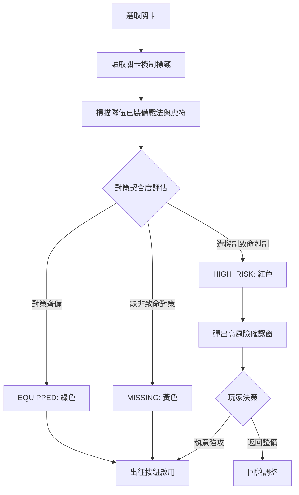

# 關卡推薦對策三態檢核與高風險挑戰許可狀態機規格書

<!-- doc_id: doc_spec_0602 -->

> 標記：Single Source of Truth（單一真相來源）  
> 涵蓋工作包：`LVL-04`  
> 狀態：正式發布 / 核心邏輯規格

---

## 1. 系統定位與架構

本模組規範戰役關卡出征前「戰法與兵種對策檢核引擎（`LoadoutCheck`）」。在進入連環破或主題關卡前，系統比對玩家「當前出征軍勢已裝備戰法與虎符兵種」，產出「已具備（EQUIPPED）」、「缺少對策（MISSING）」與「高風險剋制（HIGH_RISK）」三態評估。

本架構恪守「高風險仍可挑戰（High-Risk Permitted）」準則：即便隊伍處於劣勢，系統絕不硬性鎖死「出征」按鈕，而是彈出戰術風險警示與軍師勸阻，保留玩家挑戰極限的自由度。



---

## 2. 三態檢核資料模型與演算法（LVL-04）

```typescript
export type LoadoutMatchStatus = 'EQUIPPED' | 'MISSING' | 'HIGH_RISK';

export interface IStageCounterRequirement {
  readonly requiredMechanicTag: string; // 例如：'FIRE_RESIST', 'ANTI_CAVALRY'
  readonly isFatalCounter: boolean;      // 致命機制（缺少即構成 HIGH_RISK）
  readonly counterTacticIds: readonly string[]; // 可滿足對策之戰法
  readonly counterTroopTypes: readonly string[];// 可滿足對策之兵種
}

export interface ILoadoutCheckResult {
  readonly stageId: string;
  readonly overallStatus: LoadoutMatchStatus;
  readonly matchedTags: readonly string[];
  readonly missingTags: readonly string[];
  readonly warningNoticeText?: string;
}
```

---

## 3. 三態評估與高風險許可狀態機

### 3.1 評估邏輯
1. **已具備（`EQUIPPED`）**：關卡宣告的機制對策，隊伍已穿戴戰法或參戰虎符皆可滿足。
2. **缺少對策（`MISSING`）**：缺少部分非致命對策（`isFatalCounter === false`），例如受地形減速，但無滅團風險。
3. **高風險（`HIGH_RISK`）**：缺少致命對策（如赤壁大火缺少水策），或全隊兵種被敵軍重度剋制。

### 3.2 高風險許可協議（High-Risk Permitted Policy）
- 界面顯示亮紅「高風險（HIGH RISK）」印記。
- 點擊「出陣」時彈出 `UI_HIGH_RISK_WARNING`：「敵軍佈局剋制我方，強攻恐死傷慘重，是否執意出征？」
- 點選「孤注一擲」立即放行，不剝奪挑戰權限。

---

## 4. 核心演算法純函式實作

```typescript
export function evaluateStageLoadout(
  stageId: string,
  requirements: readonly IStageCounterRequirement[],
  equippedTactics: readonly string[],
  equippedTroopTypes: readonly string[]
): ILoadoutCheckResult {
  const matchedTags: string[] = [];
  const missingTags: string[] = [];
  let hasFatalMissing = false;

  for (const req of requirements) {
    const tacticMatched = req.counterTacticIds.some(id => equippedTactics.includes(id));
    const troopMatched = req.counterTroopTypes.some(type => equippedTroopTypes.includes(type));

    if (tacticMatched || troopMatched) {
      matchedTags.push(req.requiredMechanicTag);
    } else {
      missingTags.push(req.requiredMechanicTag);
      if (req.isFatalCounter) hasFatalMissing = true;
    }
  }

  const overallStatus: LoadoutMatchStatus = hasFatalMissing
    ? 'HIGH_RISK'
    : missingTags.length > 0 ? 'MISSING' : 'EQUIPPED';

  return {
    stageId,
    overallStatus,
    matchedTags,
    missingTags,
    warningNoticeText: hasFatalMissing ? '敵軍佈局嚴重剋制我方！' : undefined,
  };
}
```

---

## 5. 驗收與測試標準

1. **三態評估精準度檢驗（TC-LVL-04-01）**：
   - 全對策滿足返回 `EQUIPPED`；缺非致命對策返回 `MISSING`；缺致命對策返回 `HIGH_RISK`。
2. **高風險挑戰不鎖死（TC-LVL-04-02）**：
   - 檢核在 `HIGH_RISK` 下，確認挑戰回呼函式仍可正常觸發入場。
3. **動態穿戴檢驗（TC-LVL-04-03）**：
   - 驗證檢核引擎僅讀取出征陣容的即時穿戴，倉庫未裝備項不計入對策。
