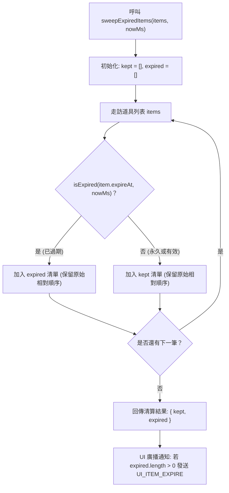

<!-- doc_id: doc_spec_0417 -->
# 限時過期道具自動回收清算與UI通知規格書

> 本規格書為 3KLife 系統限時時效道具到期判定、自動回收清算演算法與 UI 廣播通知契約之唯一真相來源（Single Source of Truth）。
> 相關實作對齊：`assets/scripts/core/systems/ItemExpiry.ts`、`ItemDef.ts`、`PlayerInventory.ts`。

---

## 1. 系統定位與架構設計

1. **背包時效清理仲裁者（Item Expiry Sweeper）**：
   - 專門負責過濾活動限時道具、短期增益符籙或過季活動票券，避免過期道具長期堆積佔用背包空間。
   - 採無副作用設計（Pure Reducer），掃描過程不原地突變（In-place Mutation）輸入陣列，純粹產出「有效保留項」與「過期回收項」兩組新清單。
2. **保守判定與防誤刪保證（Conservative Retention Principle）**：
   - 道具若未設置過期時間（`expireAt === null` 或未定義），一律視為永久道具，永不過期。
   - 若過期戳記為非法數值（`NaN`, `Infinity`），視為無法精確判定，採取安全防護原則予以保留，絕不誤刪資料。

---

## 2. 到期判定規則與數學模型

### 2.1 到期條件
對於任意帶有過期時間戳記之道具，到期判定函式定義如下：
$$\text{isExpired}(\text{expireAt}, \text{nowMs}) = (\text{expireAt} \neq \text{null}) \land \text{Number.isFinite}(\text{expireAt}) \land (\text{nowMs} \ge \text{expireAt})$$

- 當前時間 `nowMs` 正好等於 `expireAt` 之瞬間即判定為過期，杜絕邊界模糊。

---

## 3. 雙向分流清算流程（ItemExpirySweep）



### 3.1 支援物件模型
1. **通用道具型（ExpirableItem）**：以 `expireAt: number | null` 記錄過期戳記。
2. **統一物件庫實體（ExpirableRecord）**：支援以選填欄位 `expiresAt?: number | null` 進行掃描相容。

---

## 4. 介面型別契約

```typescript
export interface ExpirableItem {
    readonly id: string;
    /** 過期時間（毫秒時戳）；null 表示永久 */
    readonly expireAt: number | null;
}

export interface ItemExpirySweep<T> {
    /** 仍有效的道具（含永久與無法判定者） */
    readonly kept: T[];
    /** 本次判定為過期並回收的道具 */
    readonly expired: T[];
}

export function sweepExpiredItems<T extends ExpirableItem>(
    items: readonly T[],
    nowMs: number
): ItemExpirySweep<T>;

export function sweepExpiredRecords<T extends { expiresAt?: number | null }>(
    records: readonly T[],
    nowMs: number
): ItemExpirySweep<T>;
```

---

## 5. 驗收標準

1. **邊界時刻判定**：
   - 設定 `expireAt = 1000`，傳入 `nowMs = 999` 保留於 `kept`；傳入 `nowMs = 1000` 立即移入 `expired`。
2. **順序保真度**：
   - 分流後的 `kept` 與 `expired` 陣列，內部元素的相對順序必須與原傳入陣列完全一致。
