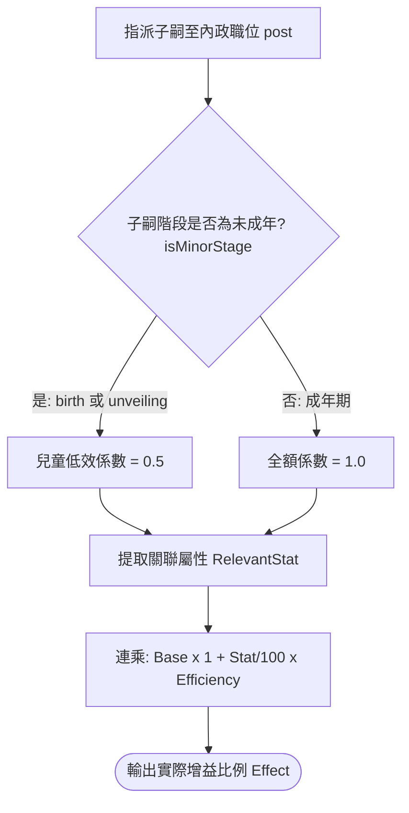

<!-- doc_id: doc_spec_0505 -->
<!-- spec_id: GOV-10 -->
# 非培育子嗣內政職位加成與未成年減半模型規格書

> 標籤：`系統規格` `領地治理` `子嗣職位` `兒童低效` `GOV-10`
> 狀態：`正式生效` · 責任模組：`ChildOfficialPosts` · 參照：`GOV-10` / `PROG-2-0988` / `PROG-2-1162`

---

## 1. 模組定位與設計理念

在三國世代傳承體系中，非進入書院或戰場培育的主力子嗣，依然能於太守府中分擔各類政務，實現「人盡其才、門閥同治」。
本規格書定義非培育子嗣四大內政職位加成計算模型（`ChildOfficialPosts.ts` 與 `ChildMagistrate.ts`），遵循以下原則：
1. **統一產能公式（Official Output）**：各職位遵循標準加成公式，受子嗣對應屬性線性放縮。
2. **差異化職能分工**：涵蓋地方民政（郡城縣令）、農業軍需（屯田官）與外交招攬（說客）。
3. **未成年兒童低效保護（Minor Inefficiency）**：幼年期子嗣效率減半，兼顧歷史真實感與成長期待。
4. **防禦性數值保護**：屬性負數視為 0，避免負向懲罰造成數值異常倒扣。

---

## 2. 職位通用計算公式 (Official_Output)

非培育子嗣指派至特定官職時，其帶來的實際增益效果比例計算公式如下：

$$\text{Effect} = \text{Base} \times \left(1 + \frac{\max(0, \text{RelevantStat})}{100}\right) \times \text{Efficiency}$$

---

## 3. 三大核心內政職位矩陣

各職位之職責、基準效益與推薦主屬性定義如下：

| 職位代碼 (`ChildOfficialPost`) | 職位中文名稱 | 基礎基準比例 (`Base`) | 關聯屬性 (`RelevantStat`) | 具體加成效果說明 |
|---|---|:---:|:---:|---|
| `magistrate` | 郡城縣令 | **+20% (0.20)** | 政治 (`pol`) | 領地商業與搜刮之**黃金產出提高**（依 `magistrateGoldBonus`） |
| `tuntian` | 屯田官 | **-20% (0.20)** | 政治 (`pol`) | 書院與家族部隊之**培育糧草消耗減少** |
| `shuike` | 招撫說客 | **+15% (0.15)** | 魅力 (`cha`) | 戰後俘虜勸降與天下傭兵**結義成功率提升** |

### 3.1 郡城縣令專屬計算 (`magistrateGoldBonus`)
- 公式：
  $$\text{Bonus} = \frac{\text{round}(20 \times (100 + \max(0, \lfloor \text{pol} \rfloor)))}{10000}$$
- 採用整數百分比運算，杜絕浮點捨入瑕疵。例如：政治 80 的縣令，提供 $20\% \times (1 + 0.8) = 36\%$ 的全域黃金產出增量。

---

## 4. 兒童低效係數機制 (CHILD_MINOR_EFFICIENCY)

為真實反映年幼子嗣在政務中的學習摸索階段：
- **未成年階段標記 (`MINOR_STAGES`)**：生命週期處於出生（`birth`）或開獎揭曉（`unveiling`）階段（未滿 15 歲）。
- **允許指派低效內政白名單**：僅限農耕（屯田官 `tuntian`）與商業（郡城縣令 `magistrate`）；軍事徵兵、治安防衛嚴格禁止。
- **低效係數 (`CHILD_MINOR_EFFICIENCY = 0.5`)**：
  未成年子嗣擔任上述允許職位時，其實際產出效果強制乘上 **`0.5`**（效率打 5 折）。
- 成年（結業入仕）後自動解除限制，可擔任全量政務並發揮 100% 完整效能。

---

## 5. 驗收標準與單元測試契約

1. **未成年減半驗證**：
   - 屯田官基準 0.20，子嗣政治 50。
   - 成年期效果：$0.20 \times (1 + 0.50) \times 1.0 = 0.30$（糧耗降低 30%）。
   - 幼年期效果：$0.20 \times (1 + 0.50) \times 0.5 = 0.15$（糧耗降低 15%）。
2. **說客魅力放縮**：
   - 說客基準 0.15，子嗣魅力 100。
   - 成年期結義成功率提升：$0.15 \times (1 + 1.0) = 0.30$（結義成功率 $+30\%$）。
3. **無子嗣健全降級**：未指派或屬性為 null 時，加成比例安全回傳 0，不中斷遊戲主流程。
