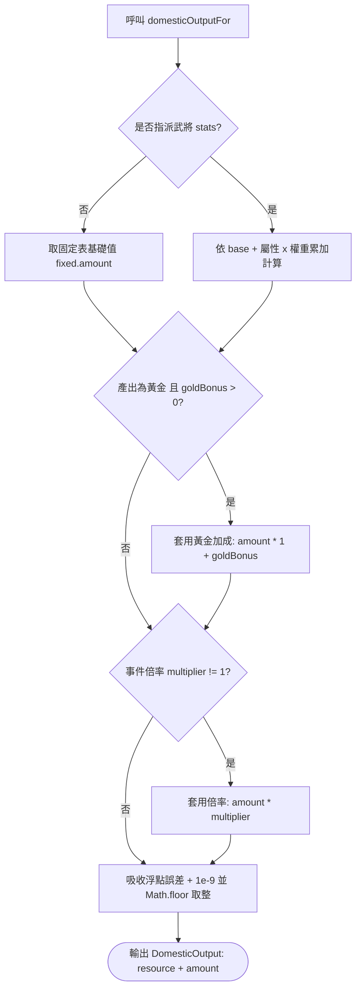
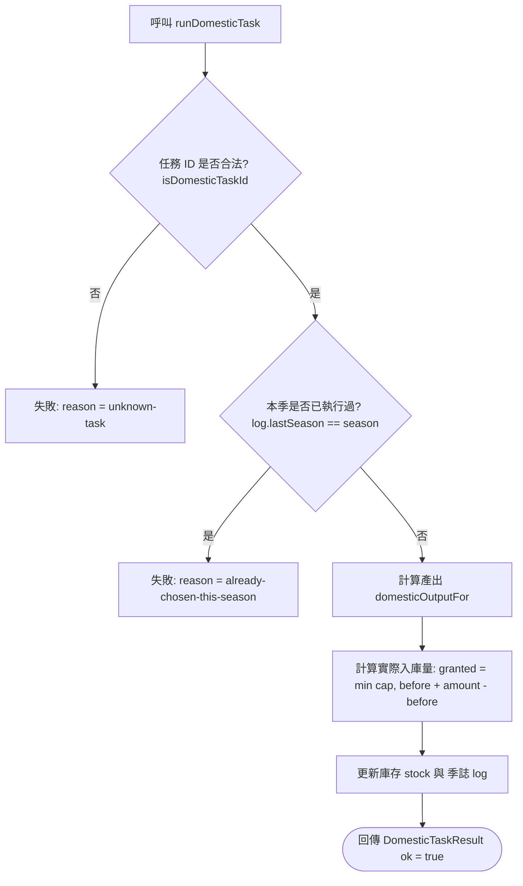

<!-- doc_id: doc_spec_0501 -->
<!-- spec_id: GOV-02 -->
# 領地內政產出加權計算與季度結算狀態機規格書

> 標籤：`系統規格` `領地治理` `產出計算` `季度狀態機` `GOV-02`
> 狀態：`正式生效` · 責任模組：`DomesticTasks` · 參照：`GOV-02` / `PROG-2-1159` / `PROG-2-1773`

---

## 1. 核心定位與設計理念

本規格書定義太守府內政任務產能的綜合運算演算法與季度執行狀態機（`DomesticTasks.ts`）。
內政結算作為季度大時鐘（Quarterly Clock）推進的核心環節，遵循以下原則：
1. **複合乘數精確結算**：將武將屬性加成、子嗣特殊官職紅利（如郡城縣令）與隨機治理事件倍率（如天災豐年）有機串聯。
2. **單季單次排他性守衛**：每季嚴格限制僅能選擇執行一項基礎內政任務，禁止重複刷取。
3. **資源存量保護原則**：產出入庫時進行上限截斷（Cap Check）；若存量因特殊獎勵已超出上限，絕不強制倒扣。
4. **純函式與日誌回溯**：執行函式無副作用，完整回傳結算日誌快照供季度季報（`Season_Report`）呈現。

---

## 2. 產能精算核心演算法 (domesticOutputFor)

單項任務產出量依據「武將指派狀態」、「黃金特權加成」與「事件全局倍率」三階段順序結算：



### 2.1 數學計算模型
1. **第一階段（基礎產能）**：
   - 未指派：$\text{amount} = \text{fixed.amount}$
   - 有指派：$\text{amount} = \text{base} + \sum (\lfloor \max(0, \text{stats}_k) \rfloor \times \text{weight}_k)$
2. **第二階段（子嗣官職加成）**：
   - 僅對產出為 `gold` 的任務生效（`commerce` 與 `scouting`）：
     $$\text{amount} = \lfloor \text{amount} \times (1 + \text{goldBonus}) + 10^{-9} \rfloor$$
3. **第三階段（治理事件倍率）**：
   - 套用如蝗災（0.5）、旱災（0.7）、大豐收（1.5）等全域事件影響：
     $$\text{amount} = \lfloor \text{amount} \times \text{multiplier} + 10^{-9} \rfloor$$

---

## 3. 季度執行狀態機 (runDomesticTask)

玩家發起內政任務執行請求時，狀態機嚴格執行以下排他檢驗：



### 3.1 狀態物件與日誌記錄 (DomesticSeasonLog)
```typescript
export interface DomesticSeasonLog {
    lastSeason: number | null;     // 上次執行之季度索引
    lastTask: DomesticTaskId | null;// 上次執行之任務識別碼
    lastGrant?: { resource: DomesticResource; amount: number }; // 實際入帳
}
```

### 3.2 存量上限防倒扣截斷機制
入庫計算遵循單調不減原則：
$$\text{after} = \max(\text{before}, \min(\text{caps}[\text{res}], \text{before} + \text{amount}))$$
$$\text{granted} = \max(0, \text{after} - \text{before})$$
- 若當前庫存已高於上限（例如上限 10,000，存量 12,000），則 $\text{after} = 12,000$，$\text{granted} = 0$，絕不把存量削回 10,000。

---

## 4. 驗收標準與單元測試契約

1. **防重複執行**：同季連續呼叫兩次，第二次必須回傳 `ok: false` 且 `reason: 'already-chosen-this-season'`。
2. **跨季解鎖**：當 `season` 遞增推進後，可正常選擇並記錄新 `lastSeason`。
3. **浮點精確性**：$100 \times 1.3$（30% 加成）必須精確產出 130，不出現 129 誤差。
