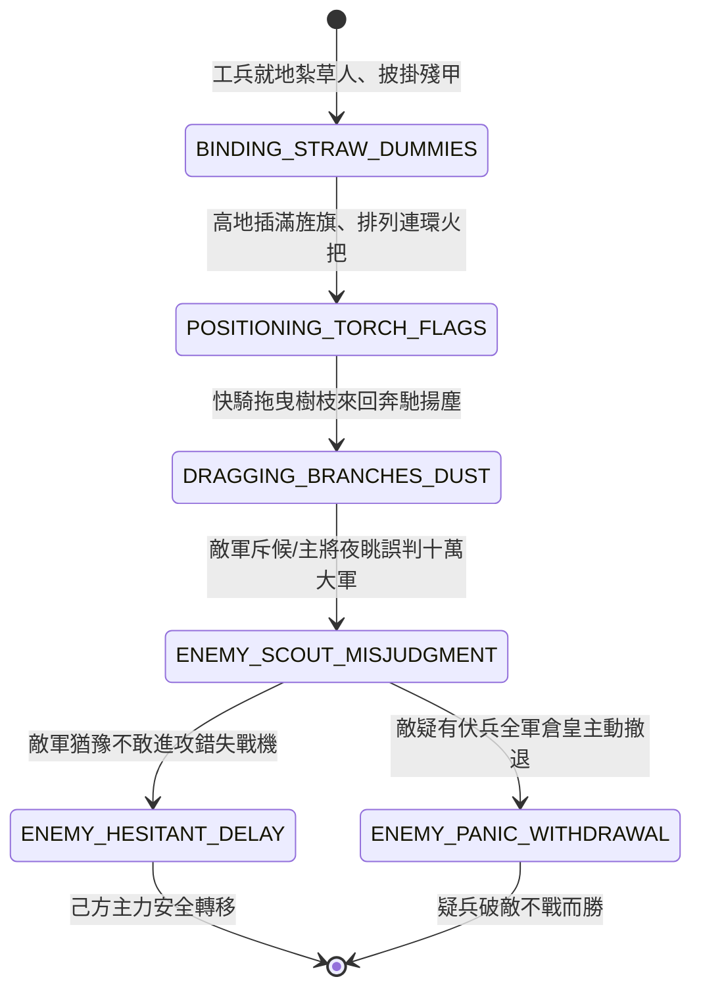

<!-- doc_id: doc_spec_0827 -->
# 3KLife 黑夜疑兵立插無數稻草人披掛甲冑旌旗虛張聲勢狀態機規格書

## 模組基本資訊
- **模組代號**：`STRAW-SOLDIER-DECEPTION01`
- **系統定位**：三國戰場夜戰虛實疑兵欺瞞系統，負責稻草假人綁紮披甲、旌旗列陣、拖枝揚塵製造伏兵、敵軍遠眺誤判與主動退兵之完整狀態流。
- **架構依賴**：`BattleGridSystem`、`TimeOfDaySystem`、`MoraleSystem`、`VFXBlockRegistry`。

---

## 核心設計概念
兵者詭道也，能而示之不能，用而示之不用（如張飛當陽斷橋虛張聲勢、曹操疑兵之計）。當己方兵力極度單薄處於劣勢時，名將常於黃昏或夜間利用林木高地，立插數百具以枯稻草紮成之「假人草人」，外罩破舊皮甲兜鍪、手縛長竹矛，插上無數雜色旌旗。陣後僅留十餘騎以長繩拖曳乾樹枝在林後沙土狂奔，揚起沖天塵土，並布設連環火把。敵軍夜盲遠眺，誤以為林後隱藏數萬精銳伏兵，震懾猶豫不敢輕進，甚至慌亂退軍。



---

## 狀態機定義與轉換條件

### 1. `BINDING_STRAW_DUMMIES`（紮草編人狀態）
- **進入條件**：己方部隊兵力少於敵方 30%，於黃昏（17:00 後）下達「布置夜間疑兵」指令。
- **行為表現**：
  - 消耗 100 份稻草與 20 件損壞皮甲，在 3x3 區域地格立起 60 具稻草假人。
- **轉換**：草人豎立完成 -> 轉移至 `POSITIONING_TORCH_FLAGS`。

### 2. `POSITIONING_TORCH_FLAGS`（插旗點火狀態）
- **行為表現**：
  - 插立雜色戰旗 50 面，假人胸前點亮松脂火把。
  - 夜間視覺效果呈現密密麻麻之「長蛇軍陣」。
- **轉換**：火把旌旗就位 -> 轉移至 `DRAGGING_BRANCHES_DUST`。

### 3. `DRAGGING_BRANCHES_DUST`（拖枝揚塵狀態）
- **行為表現**：
  - 5 騎游騎於林後沙地往返疾馳，長繩拖曳巨型松枝。
  - 生成高達 3 丈之漫天沙塵土霧 VFX，伴隨戰馬踏地轟鳴與胡亂吶喊。
- **轉換**：敵軍前鋒斥候靠近至 6 格觀察視角 -> 轉移至 `ENEMY_SCOUT_MISJUDGMENT`。

### 4. `ENEMY_SCOUT_MISJUDGMENT`（敵軍誤判審定狀態）
- **行為表現**：
  - 敵軍主將觸發智力與性格檢定（「多疑謹慎」性格誤判率 +40%）。
  - 系統計算欺瞞值：基礎欺瞞值高達 80%。
- **轉換**：
  - 敵主將性格謹慎猶豫 -> 轉移至 `ENEMY_HESITANT_DELAY`。
  - 敵主將膽怯多疑 -> 轉移至 `ENEMY_PANIC_WITHDRAWAL`。

### 5. `ENEMY_HESITANT_DELAY`（敵軍躊躇拖延狀態）
- **行為表現**：
  - 敵軍原地扎營按兵不動，停止進攻 3 個回合。
  - 己方藉機完成傷患後撤與主力轉移。
- **轉換**：拖延回合結束天明識破草人 -> 結束退出。

### 6. `ENEMY_PANIC_WITHDRAWAL`（疑懼後退狀態）
- **行為表現**：
  - 敵主將驚呼「林後必有精兵伏焉！速退！」。
  - 敵全軍後撤 5 格，士氣扣減 20 點。
- **轉換**：敵退走 -> 結束退出。

---

## 數值公式與配置契約

```typescript
export interface StrawSoldierDeceptionConfig {
  tacticId: string;
  strawDummyCount: number;         // 稻草假人數量
  baseDeceptionChance: number;     // 基礎欺瞞成功率 (0.0 ~ 1.0)
  cautiousWarlordDeceptionBonus: number;// 多疑主將受騙加成
  delayedTurnsCount: number;       // 拖延敵軍回合數
  dustCloudVisibilityReduction: number; // 揚塵遮蔽視野格數
}

export const STRAW_DECEPTION_PRESETS: Record<string, StrawSoldierDeceptionConfig> = {
  ZHANGFEI_BRIDGE_BLUFF: {
    tacticId: 'BLUFF_ZHANGFEI_01',
    strawDummyCount: 60,
    baseDeceptionChance: 0.80,
    cautiousWarlordDeceptionBonus: 0.40,
    delayedTurnsCount: 3,
    dustCloudVisibilityReduction: 4,
  }
};
```

---

## 單元測試與驗收標準
1. **多疑性格百分百受騙**：面對具備「多疑」標籤之敵將（如曹操），夜間疑兵欺瞞率達到 100%，敵軍 100% 停止進攻。
2. **夜間視野阻斷檢定**：拖枝揚塵產生地格土霧特效，敵軍偵測距離強制壓縮至 2 格以內。
3. **主力安全脫離**：疑兵拖延 3 回合期間，己方撤退部隊完全脫離戰鬥判定，無追擊戰損。
